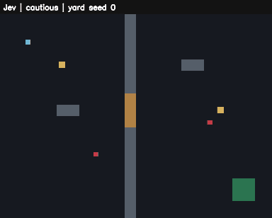

[English](README.md) | **한국어**

# Shakedown

Shakedown은 게임용 AI 플레이테스트 파이프라인이다. 오프라인 검증 경로가 있다.

- 게임 안의 실행기가 일반 입력 경로로 게임을 플레이한다.
- Shakedown은 결정과 입력을 하나씩 기록한다. 이 기록으로 지원되는 결정론적 실패를 재현할 수 있다.
- 플래너는 실행 사이에 구조화된 초안을 쓴다.
- 승인된 캠페인은 기준선을 측정할 수 있다. 또한 튜닝 값을 탐색하고, 보류 시드에서 제안을 평가할 수 있다.

> **상태: 초기 단계.**
>
> 마일스톤 M0~M7은 다음 항목의 실행 경로를 구현했다.
>
> - 프로토콜과 오프라인 디사이더
> - 예제 게임 2개
> - 재생과 격리 배치
> - QA
> - 플래너 초안과 승인된 밸런스 탐색
> - 에이전트 스킬
> - 선택적 Jev 호스팅 디사이더
>
> 다음 항목은 완료되지 않았다.
>
> - 실제 플래너와 실제 공급자의 검증
> - 어댑터 작성자가 처음 보는 게임으로의 일반화
> - 사람 플레이어를 통한 검증
>
> 어떤 명령도 제안 기본값을 적용하거나 커밋하지 않는다. 자세한 내용은 [설계 문서](docs/ko/README.md)와 [로드맵](docs/ko/09-roadmap.md)을 참고한다.

## 동작 방식

설계는 세 계층으로 구성된다. 계층마다 동작 속도가 다르다. 플래너는 배치 사이에서 동작한다. 플레이 중에 Shakedown은 기본으로 오프라인 디사이더를 쓴다. 설정한 Jev 백엔드를 선택할 수도 있다.

- **플래너(planner).** Claude Code나 Codex 같은 LLM이 실행(run) 배치(batch) 사이에 테스트 캠페인을 쓴다. 플래너는 플레이어 프로필(profile)을 고르고, 가설을 쓰고, 탐색할 튜닝(tuning) 범위를 정한다. Shakedown은 플레이 중에 플래너를 호출하지 않는다.
- **디사이더(decider).** 빠른 결정 모델이 합법적 선택지 목록에서 전술 하나를 고른다. 이 목록은 게임이 만든다. 디사이더는 좌표를 계산하거나 조준하지 않는다. 무작위 기준선, 게임 규칙, 테이프 재생기의 세 디사이더는 네트워크 없이 동작한다.
- **실행기.** 게임 안의 코드가 선택된 전술을 매 프레임 키보드·마우스 입력으로 바꾼다. 실행기는 사람 플레이어와 같은 입력 경로를 쓴다. 실행기는 게임별 어댑터(adapter)의 일부다. [Shakedown 스킬](skill/shakedown/SKILL.md)은 어댑터 작성을 돕는 가이드와 전송 골격을 제공한다.

다음 두 규칙이 실행을 결정론적으로 유지한다.

- 디사이더가 답을 계산하는 동안 게임 시간이 멈춘다. 따라서 모델 지연 시간은 결과를 바꾸지 않는다.
- Shakedown은 답을 하나씩 테이프에 기록한다. 따라서 모델을 다시 호출하지 않고 실행을 그대로 재생할 수 있다.

Shakedown은 다음과 같이 문제를 찾고 분류한다.

- 코드 수준의 오라클이 끼인 플레이어, 순간이동, 범위를 벗어난 수치를 찾는다.
- 실행기(runner)가 크래시와 다른 무효 시도를 기록한다.
- 분류(triage)는 재현된 발견과 누락·실패한 증거를 구분한다. 분류는 재생에서 클립을 만들 수 있다.
- 밸런스 루프는 탐색 시드와 보류 시드를 분리한다. 밸런스 루프는 사람 검토용 제안을 쓴다.

## 실제 실행 예시



[MP4 버전 (47초, H.264)](docs/media/live-playtest-codex-jev.mp4)

이 클립은 2026-11-06에 탐색 목적으로 한 번 돌린 캠페인에서 나왔다. 이 캠페인은 검증용 실행이 아니다. 캠페인은 다음 순서로 진행되었다.

1. Codex(`gpt-6.1-sol`, 추론 medium)가 `plan`으로 초안 2개를 썼다. 초안은 목표와 36회 기준선 캠페인이다.
2. 운영자가 두 초안을 승인했다.
3. 캠페인이 Jev(`jev-1.13.0`)와 오프라인 `rule` 디사이더를 실행했다. 조합은 시드 3개 × 맵 2개 × 프로필 3개다. 실행 1회는 시뮬레이션 시간 12초다.
4. Shakedown은 입력 재생이 원본 실행의 이벤트를 재현한 뒤에만 클립을 만들었다.

클립은 다음 순서로 실행을 보여 준다. Jev 조심형, Jev 공격형, Jev 약탈형, `rule` 공격형 순서다. `rule` 공격형 실행은 탈출한다. 화면은 다음 색을 쓴다.

| 색 | 대상 |
| --- | --- |
| 하늘색 | 플레이어 |
| 빨강 | 경비병 |
| 노랑 | 상자(플레이어가 약탈한 뒤 회색) |
| 갈색 | 문 |
| 초록 | 탈출 구역 |

실행 결과는 다음과 같다.

- 36회 실행이 모두 유효했다. 오라클은 문제를 찾지 못했다.
- Jev는 결정을 247회 했다. 이 중 17회(6.9 %)는 `random` 대체를 썼다.
- 지연 시간은 p50에서 218 ms, p95에서 306 ms였다.
- 프로필 지시문이 Jev가 고른 전술 구성을 바꾸었다. 조심형은 `hold`와 `withdraw`를 썼다. 공격형은 `hold`와 `engage`를 썼다. 약탈형은 주로 `search`를 썼다.
- 결과 지표는 `rule` 디사이더가 더 좋았다. `rule`은 공격형 실행 6회에서 모두 탈출했다. Jev 공격형 실행은 움직이지 않았다.

> **참고:** 시드 3개와 12초 실행은 디사이더의 가치(로드맵의 E1 실험)를 측정하기에 표본이 너무 작다. 이 실행은 예시다. 모델 디사이더가 도움이 된다는 증거가 아니다.

## 요구 사항

- Shakedown 쪽: Python 3.11 이상. Shakedown은 표준 라이브러리만 쓴다.
- 다음 두 가지를 할 수 있는 게임:
  - 시드에서 시작해 고정 시뮬레이션 스텝으로 헤드리스 실행한다.
  - 자기 시계를 멈춘다.

전체 계약은 설계 문서 3장에 있다.

## 사용해 보기

### 테스트 실행

테스트에는 네트워크와 설치가 필요하지 않다.

1. 테스트를 실행한다.

   ```bash
   python -m unittest discover -s tests -v
   ```

### rule 디사이더로 tinyraid 실행

다음 절차는 저장소 루트에서 한다.

1. tinyraid를 자체 rule 디사이더로 실행하고 입력을 기록한다.

   ```bash
   python -m examples.tinyraid --seed 7 --duration 45 --profile-name looter --decider rule --telemetry runs/tinyraid-rule/telemetry.jsonl --record-inputs runs/tinyraid-rule/inputs.json
   ```

2. 기록한 입력을 재생한다. 이 절차는 디사이더를 쓰지 않는다.

   ```bash
   python -m examples.tinyraid --replay-inputs runs/tinyraid-rule/inputs.json --telemetry runs/tinyraid-input-replay/telemetry.jsonl
   ```

### 브리지로 mock 실행 기록

1. 패키지를 설치한다.

   ```bash
   python -m pip install --no-build-isolation -e .
   ```

2. 브리지로 `mock` 실행을 기록한다.

   ```bash
   python -m shakedown bridge --decider mock --run-dir runs/tinyraid-mock -- python -m examples.tinyraid --seed 7 --duration 12 --decider bridge --telemetry runs/tinyraid-mock/telemetry.jsonl --record-inputs runs/tinyraid-mock/inputs.json
   ```

3. 어댑터 안에서 브리지의 결정 테이프를 재생한다.

   ```bash
   python -m examples.tinyraid --seed 7 --duration 12 --decider tape:runs/tinyraid-mock/decision_tape.jsonl --telemetry runs/tinyraid-tape/telemetry.jsonl
   ```

> **참고:**
>
> - 설치는 컴퓨터에 이미 있는 빌드 도구를 쓴다. `setuptools`가 없으면 먼저 설치한다.
> - Python Scripts 디렉터리가 `PATH`에 있으면 `python -m shakedown` 대신 `shakedown`을 쓸 수 있다.
> - 예제는 이 소스 체크아웃에만 있다. 따라서 예제 명령은 저장소 루트에서 실행한다.

실행은 다음 파일을 쓴다.

- 브리지는 `decision_tape.jsonl`, `bridge_summary.json`, `stdout.log`를 쓴다.
- 게임은 요청한 텔레메트리와 입력 기록을 쓴다.

[8장](docs/ko/08-example-game.md)에 고정 M1 시드 조합, 버그 픽스처, 선택적 PNG 프레임이 있다. 다음 절은 배치 실행, 적합성 검사, QA, M4 플래너의 명령을 설명한다.

## 배치 실행과 어댑터 검사

이 절차 전에 "사용해 보기"의 편집 가능 설치를 먼저 한다.

> **참고:** 명령마다 새 출력 디렉터리를 쓴다. Shakedown은 기존 증거를 절대 덮어쓰지 않는다.

1. 시드 1개, 맵 2개, 프로필 3개로 짧은 배치를 실행한다.

   ```bash
   python -m shakedown run --config examples/tinyraid/shakedown.toml --output runs/tinyraid-batch --seeds 1 --seconds 1 --workers 2
   ```

2. 어댑터 검사를 실행한다. 어댑터 검사는 증거를 따로 보관한다.

   ```bash
   python -m shakedown check-adapter --config examples/tinyraid/shakedown.toml --output runs/tinyraid-checks
   ```

다음 옵션으로 배치를 바꿀 수 있다.

- `--seeds`와 `--seconds`를 쓰지 않으면 예제는 설정된 60회 실행을 쓴다. 시드 10개 × 맵 2개 × 프로필 3개, 실행마다 12초다.
- `--seconds 45`는 시뮬레이션 한도를 45초로 정한다.
- `--deciders rule,mock,random`은 오프라인 정책 간 비교를 추가한다.

배치는 다음 항목을 쓴다.

- `batch.json`, `metrics.json`, `findings.jsonl`
- 실행마다 디렉터리 1개

Shakedown은 결과를 다음과 같이 센다.

- 무효 실행은 제출 횟수에 남는다. 비교에는 쓰지 않는다.
- 어댑터 검사는 `conformance.json`을 쓴다. 이 파일에는 C1~C7 판정과 증거 경로가 있다.
- 게임별 픽스처가 없으면 그 검사는 `unmeasured`다. `unmeasured` 검사는 절대 통과가 아니다.

명령은 다음 종료 코드를 쓴다.

| 명령 | 종료 코드 | 의미 |
| --- | --- | --- |
| `run` | 0 | 발견 없음 |
| `run` | 1 | 발견 1개 이상 |
| `run` | 2 | 설정 오류 |
| `run` | 130 | 배치 중단. 배치가 남은 시도를 기록한 뒤 종료 |
| `check-adapter` | 0 | 모든 검사 통과 |
| `check-adapter` | 1 | 검사 1개 이상 실패 또는 `unmeasured` |
| `check-adapter` | 2 | 설정 오류 |

> **참고:** 이 CLI 코드는 게임의 오라클 종료 코드 4와 다르다.

## 탐색, 분류, 클립

제한된 탐색은 설정된 맵, 프로필, 오프라인 디사이더를 쓴다. 다음 명령은 세 종류의 데이터를 분리한다. 표본 추출한 계획, 측정한 신호, 재현 증거다.

1. 제한된 탐색을 실행한다.

   ```bash
   python -m shakedown explore --config examples/tinyraid/shakedown.toml --output runs/tinyraid-explore --runs 6 --seed 17
   ```

2. 탐색 배치에서 이상 징후를 찾는다.

   ```bash
   python -m shakedown anomalies --config examples/tinyraid/shakedown.toml --batch runs/tinyraid-explore
   ```

3. 배치를 분류하고 클립을 만든다.

   ```bash
   python -m shakedown triage --config examples/tinyraid/shakedown.toml --batch runs/tinyraid-explore --output runs/tinyraid-triage --clips
   ```

### 탐색

- 셀은 맵, 프로필, 디사이더, 변형의 조합 1개다. 탐색은 커버리지가 가장 적은 셀을 고른다.
- 셀마다 섞은 시드 풀이 있다. 탐색은 풀의 시드를 모두 쓴 뒤에 시드를 다시 쓴다.
- 탐색은 한 번에 실행 1개를 한다. 따라서 `--deadline <seconds>`로 새 작업을 멈추고 진행 중인 실행에 한도를 둘 수 있다.
- `exploration.json`은 전체 계획과 건너뛴 추출을 보관한다. 배치 분모에는 시도한 실행이 들어간다.
- `--tuning-noise 1`~`3`은 키 테이블 값을 정해진 한도 안에서 표본 추출한다.
- `--no-steer`를 쓰면 탐색은 커버리지가 적은 셀로 유도하지 않는다.

### 이상 징후

`anomalies.json`과 `anomalies.md`는 조사할 측정 그룹을 보여 준다. 그룹은 다음 조건이 모두 참일 때만 플래그를 받는다.

- 그룹에 최소 표본 수가 있다.
- 그룹의 Wilson 하한이 설정된 임계값보다 크다.
- 그룹의 비율이 측정된 전체 비율보다 크거나, `--baseline` 정상 배치의 비율보다 크다.

누락된 기회는 `unmeasured`로 남는다. 플래그는 확인된 버그가 아니다.

### 분류

분류는 다음 항목을 보관한다.

- `findings/index.json`과 요약
- 원본 해시
- 결정론적 `bug_draft.json` 파일
- 재현 시도

분류는 다음 규칙으로 동작한다.

- 오라클 발견이나 이상 징후 발견을 확인하려면 재현 2개가 필요하다. 정책·테이프 재현과 독립 입력 재생이다.
- 분류는 알려진 시그니처의 중복을 합친다. 이를 조용히 다시 시도하지 않는다.
- 초안은 LLM을 호출하지 않는다. 원인을 지어내지 않는다.
- `--clips`를 쓰면 일치하는 입력 재생이 애니메이션 GIF를 만들 수 있다. 선택적 외부 인코더로 다른 형식을 만들 수 있다.

QA 명령은 다음 종료 코드를 쓴다.

| 명령 | 종료 코드 | 의미 |
| --- | --- | --- |
| `explore` | 1 | 실행 발견, 오라클 발견, 또는 이상 징후 플래그 |
| `explore` | 130 | 중단 |
| `anomalies` | 1 | 플래그 1개 이상 |
| `triage` | 1 | 시그니처 1개 이상이 재현되지 않았거나 `unmeasured` |
| `bench` | 0 | 검증 게이트 통과 |
| `bench` | 1 | 실패하거나 검증되지 않은 커버리지 |
| `bench` | 130 | 중단 |
| 모두 | 2 | 설정 오류 |

### 벤치마크

통제된 tinyraid 벤치마크는 서로 겹치지 않는 탐색 시드와 보류 시드를 쓴다. 정상 게임과 단일 결함 게임에 같은 입력 워크플로 탐침을 적용한다. [8장](docs/ko/08-example-game.md#84-벤치마크)에 다음 내용이 있다.

- 전체 명령
- 검증 규칙
- 테스트베드 커버리지와 처음 보는 게임에서의 자율 발견 사이의 경계

## 플래너 초안과 승인된 캠페인

M4는 명령 3개를 추가한다. `plan`, `approve`, `campaign`이다.

- `plan`에는 모드 5개가 있다. `targets`, `campaign`, `revise`, `bug`, `report`다.
- 오프라인 초안에는 `--backend mock`을 쓴다. CLI 백엔드를 쓰려면 명시적으로 설정한다.
- 입력 파일을 주려면 파일마다 `--input NAME=PATH` 인수를 1개씩 추가한다.
- Shakedown은 초안마다 스키마 검사와 의미 검사를 한다. 초안은 이 검사를 통과한 뒤에만 쓸 수 있다.

[5장](docs/ko/05-planner-and-skill.md)에 명령 계약, 예산, 백엔드 제한이 있다.

대문자 값은 운영자가 제공하는 경로다. 다음 절차를 순서대로 한다.

1. 목표 초안을 쓴다. 이 명령은 `DRAFT_DIR/targets.json`을 쓴다.

   ```text
   python -m shakedown plan targets --config CONFIG --input design_notes=DESIGN_FILE --output DRAFT_DIR --backend mock
   ```

2. 목표를 검토한다. 그다음 목표의 승인 영수증을 만든다.

   ```text
   python -m shakedown approve targets --config CONFIG --artifact TARGETS_JSON --receipt TARGETS_RECEIPT --approved
   ```

3. 캠페인 초안을 쓴다. 이 명령은 `CAMPAIGN_DIR/campaign.json`을 쓴다.

   ```text
   python -m shakedown plan campaign --config CONFIG --input design_notes=DESIGN_FILE --targets TARGETS_JSON --targets-approval TARGETS_RECEIPT --output CAMPAIGN_DIR --backend mock
   ```

4. 캠페인을 검토한다. 그다음 캠페인의 승인 영수증을 만든다.

   ```text
   python -m shakedown approve campaign --config CONFIG --artifact CAMPAIGN_JSON --receipt CAMPAIGN_RECEIPT --targets TARGETS_JSON --targets-approval TARGETS_RECEIPT --approved
   ```

5. 캠페인을 실행한다.

   ```text
   python -m shakedown campaign --config CONFIG --campaign CAMPAIGN_JSON --approval CAMPAIGN_RECEIPT --targets TARGETS_JSON --targets-approval TARGETS_RECEIPT --output RUN_DIR --approved
   ```

승인 영수증의 성질은 다음과 같다.

- 영수증은 승인을 산출물과 설정의 내용에 묶는다.
- 영수증은 서명되지 않은 운영자의 주장이다. 인증된 서명이 아니다.
- 승인된 내용을 바꾸면 새 영수증을 만들어야 한다.

### 밸런스 루프

- `--optimize` 없이 캠페인은 기준선 라운드 1회를 실행한다.
- `--optimize`를 쓰면 캠페인은 M5 밸런스 루프를 실행한다. 밸런스 루프에는 승인된 캠페인과 `[balance]` 설정이 필요하다.

밸런스 루프는 다음 절차를 한다.

1. 정책과 프로필 지시문을 고정한다.
2. 탐색 시드에서 후보의 순위를 정한다.
3. 선택한 후보를 동결한다.
4. 서로 겹치지 않는 보류 시드에서 이 후보를 1회 평가한다.

밸런스 루프에는 다음 규칙이 있다.

- 모든 실험은 캠페인의 공유 탐색 범위를 써야 한다.
- 제안에는 시험한 정책이 2개 이상 필요하다. 합의는 이 정책에만 적용된다.

[7장](docs/ko/07-balance-loop.md)에 설정, 게이트, 출력 파일이 있다.

통과한 후보는 `defaults.patch`, `tuning.json`, `proposal.json`을 만든다. 어떤 명령도 이 파일을 적용하거나 커밋하지 않는다.

- 패치는 튜닝 키 테이블의 문서화된 기본값을 바꾼다.
- tinyraid는 이 테이블을 런타임 기본값의 원본으로 읽는다.
- 다른 어댑터는 사람이 패치를 적용하기 전에 자체 통합을 갖춰야 한다.

### 플래너 예산

- 플래너 호출 전마다 Shakedown은 설정된 금액을 원장에 예약한다.
- 비용 데이터가 없으면 그 호출은 예약 전체를 쓴다.
- 이 예약은 Shakedown이 허용하는 호출에 한도를 둔다. 공급자의 최종 청구액에는 한도를 두지 않는다.
- Codex에는 명시적 동의가 필요하다. `codex_mode = "restricted"`다. Codex는 도구를 쓰지 않는다는 검증된 보장을 제공하지 않는다.
- 설치된 CLI 백엔드를 수동으로 호출하려면 별도로 승인된 예산이 필요하다.
- 오프라인 검증은 실제 공급자의 동작을 증명하지 않는다.

## 두 번째 어댑터와 에이전트 스킬

`examples/switchyard/`는 작은 턴제 경로 퍼즐이다. 얇은 실행기가 있다. 후보는 하나씩 일반 버튼이 된다. 자체 설정으로 어댑터 검사와 오프라인 배치 실행을 시험한다.

> **참고:** 새 출력 디렉터리를 쓴다.

1. 어댑터 검사를 실행한다.

   ```bash
   python -m shakedown check-adapter --config examples/switchyard/shakedown.toml --output runs/switchyard-checks
   ```

2. 배치를 실행한다.

   ```bash
   python -m shakedown run --config examples/switchyard/shakedown.toml --output runs/switchyard-batch
   ```

스킬의 증거에는 다음 한계가 있다.

- 동봉된 어댑터는 스킬을 읽기 전에 있었다. 따라서 그 검증만으로는 사전 지식 없는 생성을 증명하지 않는다.
- 별도 시험은 새 컨텍스트를 썼다. 에이전트는 스킬, 게임 규칙, 프로토콜, 설정만 읽었다. 동봉된 어댑터는 읽지 않았고, 독립 어댑터를 썼다.
- 이 어댑터는 시드 7, `depot`, `courier`에서 C1~C6를 통과했다. 이 결과는 최소 지원 기준 C1~C3를 충족한다. C7은 `unmeasured`로 남았다.
- 이 결과는 처음 보는 게임으로의 넓은 일반화를 증명하지 않는다. C7 통과도 증명하지 않는다.

[스킬](skill/shakedown/SKILL.md)에는 다음 항목이 있다.

- 어댑터 가이드
- 얇은 실행기 가이드
- Python, C++17, C#, GDScript 전송 골격
- 가시성 픽스처 패턴
- 이식 가능한 명령 래퍼

이 항목은 출발점이다. 게임 적합성 검증을 대신하지 않는다.

## 선택적 호스팅 결정

M7 `jev` 백엔드는 고정 선택지 질문을 브리지로 보낸다. 백엔드에는 다음 부분이 있다.

- 정확한 모델 고정
- 공유 캐시와 원장
- 한도가 있는 재시도
- 지연 시간, 대체, 사용량 영수증

API 키는 설정된 환경 변수에 둔다. Shakedown은 게임의 환경에서 키를 제거한다. [4장](docs/ko/04-deciders.md)에 설정과 명령이 있다.

증거에는 다음 한계가 있다.

- 로컬 HTTP 픽스처는 전송 동작을 증명한다.
- 실제 호스팅 추론, 운영 지연 시간, 실제 청구액은 `unmeasured`다.
- 토큰 기반 비용 추정과 보수적 예약은 공급자의 청구액을 증명하지 않는다.

## 라이선스

[Apache License 2.0](LICENSE).
