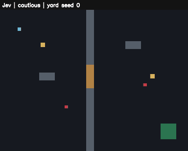

**English** | [한국어](README.ko.md)

# Shakedown

Shakedown is an AI playtest pipeline for games. It has an offline test path.

- An executor in the game plays the game through the usual input path.
- Shakedown records each decision and each input. With these records, you can reproduce supported deterministic failures.
- Between runs, the planner writes structured drafts.
- An approved campaign can measure a baseline. It can also search for tuning values and evaluate the proposals on held-out seeds.

> **Status: early.**
>
> Milestones M0 to M7 have implementation paths for these items:
>
> - The protocol and the offline deciders
> - Two example games
> - Replay and isolated batches
> - QA
> - Planner drafts and approved balance search
> - An agent skill
> - The optional Jev hosted decider
>
> These items are not complete:
>
> - Qualification of the live planner and the live providers
> - Generalization to more games that the adapter writer did not see before
> - Validation with human players
>
> The `apply` command writes proposed defaults only under `--approved`. No command commits them. For more data, refer to [the design documents](docs/README.md) and [the roadmap](docs/09-roadmap.md).

## How it works

The design has three layers. Each layer operates at a different speed. The planner operates between batches. During play, Shakedown uses offline deciders by default. You can also select the configured Jev backend.

- **Planner.** An LLM, for example Claude Code or Codex, writes the test campaign between batches of runs. The planner selects player profiles, writes hypotheses, and sets the tuning ranges to search. Shakedown does not call the planner during play.
- **Decider.** A fast decision model selects one tactic from a list of legal options. Your game makes this list. The decider does not calculate coordinates or aim. Three deciders operate without a network: a random baseline, a game rule, and a tape replayer.
- **Executor.** Code in your game changes the selected tactic into keyboard and mouse input in each frame. The executor uses the same input path as a human player. The executor is part of a per-game adapter. The [Shakedown skill](skill/shakedown/SKILL.md) gives guides and transport skeletons to help you write an adapter.

Two rules keep each run deterministic:

- Game time stops while the decider calculates an answer. Thus, model latency does not change the result.
- Shakedown writes each answer to a tape. Thus, you can replay a run exactly, and Shakedown does not call the model again.

Shakedown finds and sorts problems as follows:

- Code-level oracles find stuck players, teleports, and stats that are out of range.
- The runner records crashes and other invalid attempts.
- Triage separates reproduced findings from missing or failed evidence. Triage can make a clip from a replay.
- The balance loop keeps search seeds and holdout seeds separate. It writes proposals for human review.

## A live run



[MP4 version (47 s, H.264)](docs/media/live-playtest-codex-jev.mp4)

This clip is from one exploratory campaign on 2026-11-06. This campaign was not a qualification run. The campaign occurred in this sequence:

1. Codex (`gpt-6.1-sol`, medium reasoning) used `plan` to write two drafts: the targets and a baseline campaign of 36 runs.
2. An operator approved the two drafts.
3. The campaign ran Jev (`jev-1.13.0`) and the offline `rule` decider. The matrix was 3 seeds × 2 maps × 3 profiles. Each run was 12 simulated seconds.
4. Shakedown made each clip only after input replay reproduced the events of the source run.

The clips show these runs in this sequence: Jev cautious, Jev aggressive, Jev looter, and `rule` aggressive. The `rule` aggressive run extracts. The frames use these colors:

| Color | Object |
| --- | --- |
| Light blue | Player |
| Red | Guard |
| Yellow | Crate (gray after the player loots it) |
| Brown | Door |
| Green | Extraction zone |

The run showed these results:

- All 36 runs were valid. The oracles found no problems.
- Jev made 247 decisions. 17 of these decisions (6.9 %) used the `random` fallback.
- The latency was 218 ms at p50 and 306 ms at p95.
- The profile instructions changed the mix of tactics that Jev selected. Cautious used `hold` and `withdraw`. Aggressive used `hold` and `engage`. Looter used mostly `search`.
- The `rule` decider had better outcomes. It extracted in all six aggressive runs. The Jev aggressive runs did not move.

> **NOTE:** Three seeds and 12-second runs are too small a sample to measure the value of a decider (experiment E1 in the roadmap). This run is an example. It is not evidence that a model decider helps.

## Requirements

- For the Shakedown side: Python 3.11 or later. Shakedown uses only the standard library.
- A game that can do these two things:
  - Run headless on a fixed simulation step from a seed.
  - Stop its own clock.

Chapter 3 of the design gives the full contract.

## Try it

### Run the tests

The tests do not need a network or an install.

1. Run the tests:

   ```bash
   python -m unittest discover -s tests -v
   ```

### Run tinyraid with the rule decider

Do these steps from the repository root.

1. Run tinyraid with its local rule decider, and record the inputs:

   ```bash
   python -m examples.tinyraid --seed 7 --duration 45 --profile-name looter --decider rule --telemetry runs/tinyraid-rule/telemetry.jsonl --record-inputs runs/tinyraid-rule/inputs.json
   ```

2. Replay the recorded inputs. This step does not use a decider:

   ```bash
   python -m examples.tinyraid --replay-inputs runs/tinyraid-rule/inputs.json --telemetry runs/tinyraid-input-replay/telemetry.jsonl
   ```

### Record a mock run through the bridge

1. Install the package:

   ```bash
   python -m pip install --no-build-isolation -e .
   ```

2. Record a `mock` run through the bridge:

   ```bash
   python -m shakedown bridge --decider mock --run-dir runs/tinyraid-mock -- python -m examples.tinyraid --seed 7 --duration 12 --decider bridge --telemetry runs/tinyraid-mock/telemetry.jsonl --record-inputs runs/tinyraid-mock/inputs.json
   ```

3. In the adapter, replay the decision tape from the bridge:

   ```bash
   python -m examples.tinyraid --seed 7 --duration 12 --decider tape:runs/tinyraid-mock/decision_tape.jsonl --telemetry runs/tinyraid-tape/telemetry.jsonl
   ```

> **NOTE:**
>
> - The install uses the build tools that are already on your computer. If `setuptools` is not installed, install it first.
> - If the Python Scripts directory is on `PATH`, you can use `shakedown` in place of `python -m shakedown`.
> - The example is only in this source checkout. Thus, run its commands from the repository root.

The run writes these files:

- The bridge writes `decision_tape.jsonl`, `bridge_summary.json`, and `stdout.log`.
- The game writes the telemetry and the input recording that you request.

[Chapter 8](docs/08-example-game.md) gives the fixed M1 seed matrix, the bug fixtures, and the optional PNG frames. The subsequent sections give the commands for batch runs, conformance, QA, and the M4 planner.

## Batch runs and adapter checks

Do the editable install in "Try it" before you do these steps.

> **NOTE:** Use a new output directory for each command. Shakedown never writes over existing evidence.

1. Run a short batch with one seed, two maps, and three profiles:

   ```bash
   python -m shakedown run --config examples/tinyraid/shakedown.toml --output runs/tinyraid-batch --seeds 1 --seconds 1 --workers 2
   ```

2. Run the adapter checks. The adapter checks keep their evidence separately:

   ```bash
   python -m shakedown check-adapter --config examples/tinyraid/shakedown.toml --output runs/tinyraid-checks
   ```

You can change the batch with these options:

- If you do not use `--seeds` and `--seconds`, the example uses its configured 60 runs. These are 10 seeds × 2 maps × 3 profiles, 12 seconds each.
- `--seconds 45` sets the simulation limit to 45 seconds.
- `--deciders rule,mock,random` adds comparisons between offline policies.

A batch writes these items:

- `batch.json`, `metrics.json`, and `findings.jsonl`
- One directory for each run

Shakedown counts the results as follows:

- Invalid executions stay in the submitted count. The comparisons do not use them.
- The adapter checks write `conformance.json`. This file contains the C1–C7 verdicts and the evidence paths.
- If a game-specific fixture is missing, its check is `unmeasured`. An `unmeasured` check is never a pass.

The commands use these exit codes:

| Command | Exit code | Meaning |
| --- | --- | --- |
| `run` | 0 | No findings |
| `run` | 1 | One or more findings |
| `run` | 2 | Configuration error |
| `run` | 130 | Interrupted batch, after the batch records its remaining attempts |
| `check-adapter` | 0 | All checks pass |
| `check-adapter` | 1 | One or more checks failed or are unmeasured |
| `check-adapter` | 2 | Configuration error |

> **NOTE:** These CLI codes are different from the oracle exit code 4 of the game.

## Exploration, triage, and clips

A bounded exploration uses the configured maps, profiles, and offline deciders. These commands keep three types of data separate: sampled plans, measured signals, and reproduction evidence.

1. Run a bounded exploration:

   ```bash
   python -m shakedown explore --config examples/tinyraid/shakedown.toml --output runs/tinyraid-explore --runs 6 --seed 17
   ```

2. Find anomalies in the exploration batch:

   ```bash
   python -m shakedown anomalies --config examples/tinyraid/shakedown.toml --batch runs/tinyraid-explore
   ```

3. Do triage on the batch, and make clips:

   ```bash
   python -m shakedown triage --config examples/tinyraid/shakedown.toml --batch runs/tinyraid-explore --output runs/tinyraid-triage --clips
   ```

### Exploration

- A cell is one combination of map, profile, decider, and variant. Exploration selects the cell with the least coverage.
- Each cell has a shuffled seed pool. Exploration uses all seeds in the pool before it uses a seed again.
- Exploration does one run at a time. Thus, `--deadline <seconds>` can stop new work and put a limit on the active run.
- `exploration.json` keeps the complete plan and the skipped draws. The batch denominator contains the attempted runs.
- `--tuning-noise 1` to `3` samples values from the key table, in set limits.
- With `--no-steer`, exploration does not steer to the cells with low coverage.

### Anomalies

`anomalies.json` and `anomalies.md` show the measured groups to examine. A group gets a flag only if all of these conditions are true:

- The group has the minimum sample count.
- Its Wilson lower bound is more than the configured threshold.
- Its rate is more than the measured overall rate, or more than the rate of the clean batch in `--baseline`.

Missing opportunities stay `unmeasured`. A flag is not a confirmed bug.

### Triage

Triage keeps these items:

- `findings/index.json` and a summary
- Source hashes
- Deterministic `bug_draft.json` files
- Reproduction attempts

Triage operates with these rules:

- To confirm an oracle finding or an anomaly finding, triage must have two reproductions: a policy/tape reproduction and an independent input replay.
- Triage merges duplicates of known signatures. It does not silently try them again.
- The drafts do not call an LLM. They do not invent a cause.
- With `--clips`, a matching input replay can make an animated GIF. An optional external encoder can make other formats.

The QA commands use these exit codes:

| Command | Exit code | Meaning |
| --- | --- | --- |
| `explore` | 1 | Execution findings, oracle findings, or anomaly flags |
| `explore` | 130 | Interruption |
| `anomalies` | 1 | One or more flags |
| `triage` | 1 | One or more signatures are unreproduced or unmeasured |
| `bench` | 0 | The qualification gate passes |
| `bench` | 1 | Failed or unqualified coverage |
| `bench` | 130 | Interruption |
| All | 2 | Configuration error |

### Benchmark

The controlled tinyraid benchmark uses disjoint search seeds and holdout seeds. It applies the same input-workflow probes to clean games and to single-fault games. [Chapter 8](docs/08-example-game.md#84-benchmark) gives these data:

- The full command
- The qualification rules
- The boundary between test-bed coverage and autonomous discovery in an unfamiliar game

## Planner drafts and approved campaigns

M4 adds three commands: `plan`, `approve`, and `campaign`.

- `plan` has five modes: `targets`, `campaign`, `revise`, `bug`, and `report`.
- For offline drafts, use `--backend mock`. To use a CLI backend, configure it explicitly.
- To give an input file, add one `--input NAME=PATH` argument for each file.
- Shakedown does a schema check and a semantic check on each draft. You can use a draft only after it passes these checks.

[Chapter 5](docs/05-planner-and-skill.md) gives the command contract, the budgets, and the backend restrictions.

The uppercase values are paths that the operator supplies. Do these steps in sequence:

1. Write the draft targets. This command writes `DRAFT_DIR/targets.json`:

   ```text
   python -m shakedown plan targets --config CONFIG --input design_notes=DESIGN_FILE --output DRAFT_DIR --backend mock
   ```

2. Review the targets. Then make the approval receipt for the targets:

   ```text
   python -m shakedown approve targets --config CONFIG --artifact TARGETS_JSON --receipt TARGETS_RECEIPT --approved
   ```

3. Write the draft campaign. This command writes `CAMPAIGN_DIR/campaign.json`:

   ```text
   python -m shakedown plan campaign --config CONFIG --input design_notes=DESIGN_FILE --targets TARGETS_JSON --targets-approval TARGETS_RECEIPT --output CAMPAIGN_DIR --backend mock
   ```

4. Review the campaign. Then make the approval receipt for the campaign:

   ```text
   python -m shakedown approve campaign --config CONFIG --artifact CAMPAIGN_JSON --receipt CAMPAIGN_RECEIPT --targets TARGETS_JSON --targets-approval TARGETS_RECEIPT --approved
   ```

5. Run the campaign:

   ```text
   python -m shakedown campaign --config CONFIG --campaign CAMPAIGN_JSON --approval CAMPAIGN_RECEIPT --targets TARGETS_JSON --targets-approval TARGETS_RECEIPT --output RUN_DIR --approved
   ```

Approval receipts have these properties:

- A receipt binds the approval to the contents of the artifact and of the configuration.
- A receipt is an unsigned assertion by the operator. It is not an authenticated signature.
- If you change approved content, you must make a new receipt.

### Balance loop

- Without `--optimize`, a campaign runs one baseline round.
- With `--optimize`, the campaign runs the M5 balance loop. The balance loop needs an approved campaign and a `[balance]` configuration.

The balance loop does these steps:

1. It fixes the policy and the profile instructions.
2. It ranks the candidates on the search seeds.
3. It freezes the selected candidates.
4. It evaluates these candidates one time on disjoint holdout seeds.

The balance loop has these rules:

- Each experiment must use the shared search ranges of the campaign.
- A proposal needs at least two tested policies. The agreement applies only to these policies.

[Chapter 7](docs/07-balance-loop.md) gives the settings, the gate, and the output files.

The candidates that pass make `defaults.patch`, `tuning.json`, and `proposal.json`. `shakedown apply --config CONFIG --proposal PROPOSAL_DIR` verifies the receipt and patch against the live table; `--approved` then writes the new defaults. No command commits them.

- The patch changes the documented defaults in the tuning key table.
- Tinyraid reads this table as its source of runtime defaults.
- Other adapters must have their own integration before a person applies a proposal.

### Planner budgets

- Before each planner call, Shakedown reserves a configured amount in a ledger.
- If cost data is missing, the call uses all of its reservation.
- These reservations put a limit on the calls that Shakedown admits. They do not put a limit on the final bill of the provider.
- Codex needs an explicit opt-in: `codex_mode = "restricted"`. Codex does not give a verified tool-free guarantee.
- Manual calls to the installed CLI backends need a separately authorized budget.
- Offline validation does not prove the behavior of a live provider.

## Second adapter and agent skill

`examples/switchyard/` is a small turn-based route puzzle. It has a thin executor: each candidate becomes an ordinary button. Its own configuration tests the adapter checks and offline batch runs.

> **NOTE:** Use new output directories.

1. Run the adapter checks:

   ```bash
   python -m shakedown check-adapter --config examples/switchyard/shakedown.toml --output runs/switchyard-checks
   ```

2. Run a batch:

   ```bash
   python -m shakedown run --config examples/switchyard/shakedown.toml --output runs/switchyard-batch
   ```

The evidence for the skill has these limits:

- The shipped adapter existed before the skill read. Thus, its verification alone does not prove blind generation.
- A separate trial used a fresh context. The agent read only the skill, the game rules, the protocol, and the configuration. It did not read the shipped adapter, and it wrote an independent adapter.
- This adapter passed C1–C6 on seed 7, `depot`, `courier`. This result meets the minimum C1–C3 support criterion. C7 stayed `unmeasured`.
- This result does not prove broad generalization to unseen games. It does not prove a C7 pass.

The [skill](skill/shakedown/SKILL.md) contains these items:

- An adapter guide
- A thin-executor guide
- Transport skeletons for Python, C++17, C#, and GDScript
- A visibility fixture pattern
- A portable command wrapper

These items are starting points. They do not replace game conformance.

## Optional hosted decisions

The M7 `jev` backend sends fixed-choice questions through the bridge. The backend has these parts:

- An exact model pin
- A shared cache and ledger
- Retries with a limit
- Receipts for latency, fallback, and usage

Keep the API key in the configured environment variable. Shakedown removes the key from the environment of the game. [Chapter 4](docs/04-deciders.md) gives the settings and the commands.

The evidence has these limits:

- Local HTTP fixtures prove the transport behavior.
- Actual hosted inference, production latency, and actual billing are `unmeasured`.
- Token-based cost estimates and conservative reservations do not prove the charge of the provider.

## License

[Apache License 2.0](LICENSE).
